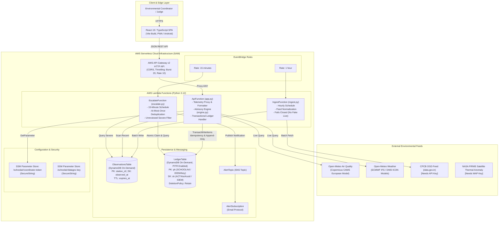

# PRAN-NET — Full-Stack & Serverless Architecture Specification

**System:** PRAN-NET (Pran Operational Mitigation Network)  
**Engineering Domain:** Environmental Intelligence, Geospatial Analytics, Human-in-the-Loop Operational Decision Systems  
**Stack:** React 19 + TypeScript + Vite, Python 3.12/3.13 Lambda Functions, AWS Serverless Application Model (SAM), DynamoDB, API Gateway v2, SNS, SSM Parameter Store.

---

## 1. High-Level Architecture Diagram



---

## 2. Component Responsibilities

### A. Frontend Layer (React 19 / TypeScript)
- **Framework:** React 19.2.0, Vite 8.3.4, TypeScript 5.9.3.
- **Design System:** PRAN Atmosphere tokenized CSS (Obsidian Dark mode & Airglass Porcelain Light mode).
- **Localization:** 13 Indian regional languages + automated right-to-left (`dir="rtl"`) layout for Urdu.
- **Geospatial Canvas:** Leaflet 1.9.4 with OpenStreetMap raster tiles, DPCC reporting station nodes, and CAMS model grid cells.
- **Human-in-the-Loop Incident Engine:** 7-stage operational console (`MitigationReviewView.tsx`) enforcing audited override justifications ($\ge 10$ chars) and client-side idempotency keys.

### B. API Gateway v2 HTTP API (`SchoolAirApi`)
- Low-latency AWS HTTP API endpoint routing all requests to `ApiFunction`.
- **Throttling Protection:** `ThrottlingBurstLimit: 20`, `ThrottlingRateLimit: 10`.
- **CORS Configuration:** Enforces allowed origins (`AllowedOrigin`) and allowed headers (`content-type, x-coordinator-token, idempotency-key, authorization`).

### C. Compute Functions (AWS Lambda / Python 3.12)
1. **`ApiFunction` (`app.py`):**
   - Handles public health (`/health`, `/health/data-sources`), telemetry proxying (`/telemetry/live`), and deterministic activity advisories (`/advisory`).
   - Protects `/actions` and `/metrics` routes using dual-header authentication (`x-coordinator-token` and `Authorization: Bearer`).
   - Executes atomic DynamoDB `TransactWriteItems` for mitigation decisions.
2. **`IngestFunction` (`ingest.py`):**
   - Scheduled hourly via Amazon EventBridge.
   - Normalizes external station data into unified NAQI categories. Fails closed: if upstream data is unavailable, it never writes synthetic data as live.
3. **`EscalateFunction` (`escalate.py`):**
   - Scheduled every 15 minutes via Amazon EventBridge.
   - Evaluates whether severe advisories (`MOVE_INDOORS`) remain unreviewed past the designated SLA window.
   - Implements **at-most-once delivery** using atomic conditional DynamoDB writes (`attribute_not_exists(notified_at)`) before publishing to SNS.

### D. Storage & Persistence Layer (Amazon DynamoDB)
1. **`ObservationsTable`:**
   - Keys: `station_id` (HASH), `observed_at` (RANGE).
   - Mode: On-Demand (`PAY_PER_REQUEST`).
   - TTL: Automatically discards telemetry older than `expires_at` to prevent unbounded table growth.
2. **`LedgerTable`:**
   - Keys: `pk` (HASH), `sk` (RANGE).
   - Mode: On-Demand (`PAY_PER_REQUEST`).
   - Protection: Point-in-Time Recovery (PITR) enabled; `DeletionPolicy: Retain` and `UpdateReplacePolicy: Retain` to ensure immutable audit trails survive stack updates.
   - Schema Pattern:
     - Action Record: `pk=SCHOOL#{school_id}`, `sk=ACT#{iso_timestamp}#{uuid}`.
     - Idempotency Claim: `pk=IDEM#{school_id}#{idempotency_key}`, `sk=IDEM`. Written transactionally with the action record to prevent duplicate entries.
     - Escalation Claim: `pk=SCHOOL#{school_id}`, `sk=ALERT#{observed_at}`.

---

## 3. End-to-End Data Flow

The platform implements a closed-loop decision architecture:

```text
[OBSERVE]
Real-Time Open-Meteo Copernicus CAMS & Weather Feeds
          │
          ▼
[INVESTIGATE]
Diagnostic PM2.5/PM10 Ratio Math & Surface Wind Dispersion Screening
          │
          ▼
[ACT]
Sector Action Workspaces (Municipal, Logistics Inhaled Dose, Campus, Agriculture)
          │
          ▼
[DECIDE]
Human-in-the-Loop Review Console (INC-2026-DEL-0842)
Audited Justification & Token Authorization
          │
          ▼
[TRANSACT]
DynamoDB TransactWriteItems (Idempotency Claim + Action Record Snapshot)
          │
          ▼
[VERIFY]
Immutable Action History Ledger Retrieval & JSON Export
```

---

## 4. Local vs. Deployed Architecture Comparison

| Architectural Dimension | Local Development Mode (`dev_server.py`) | AWS Production Deployment (`template.yaml`) |
|---|---|---|
| **API Gateway** | Python `http.server` base handler on port 8000 | AWS API Gateway v2 HTTP API (`$default` stage) |
| **Compute Execution** | Single-process daemon invoking `app.handler` | AWS Lambda Python 3.12 container runtime |
| **DynamoDB Tables** | In-process Moto DynamoDB emulator (`local_obs`, `local_ledger`) | Managed Amazon DynamoDB tables (Multi-AZ, PITR, Encrypted at Rest) |
| **Persistence Boundary** | Survives page reloads within server session | Persistent indefinitely across all invocations and updates |
| **Parameter Store** | Moto SSM Parameter Store mock | AWS Systems Manager (SSM) Parameter Store (SecureString) |
| **Escalation Notification** | In-memory notification handler | Amazon SNS Topic with confirmed email protocol subscription |
| **Task Scheduling** | Manual execution or integration tests | Amazon EventBridge rules (Hourly & 15-Minute cadences) |
